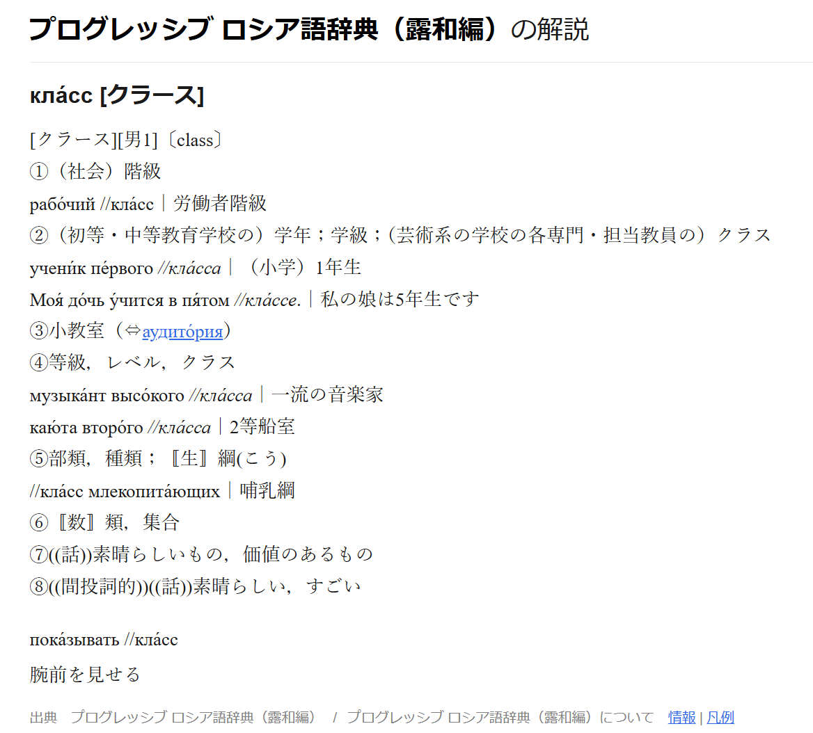
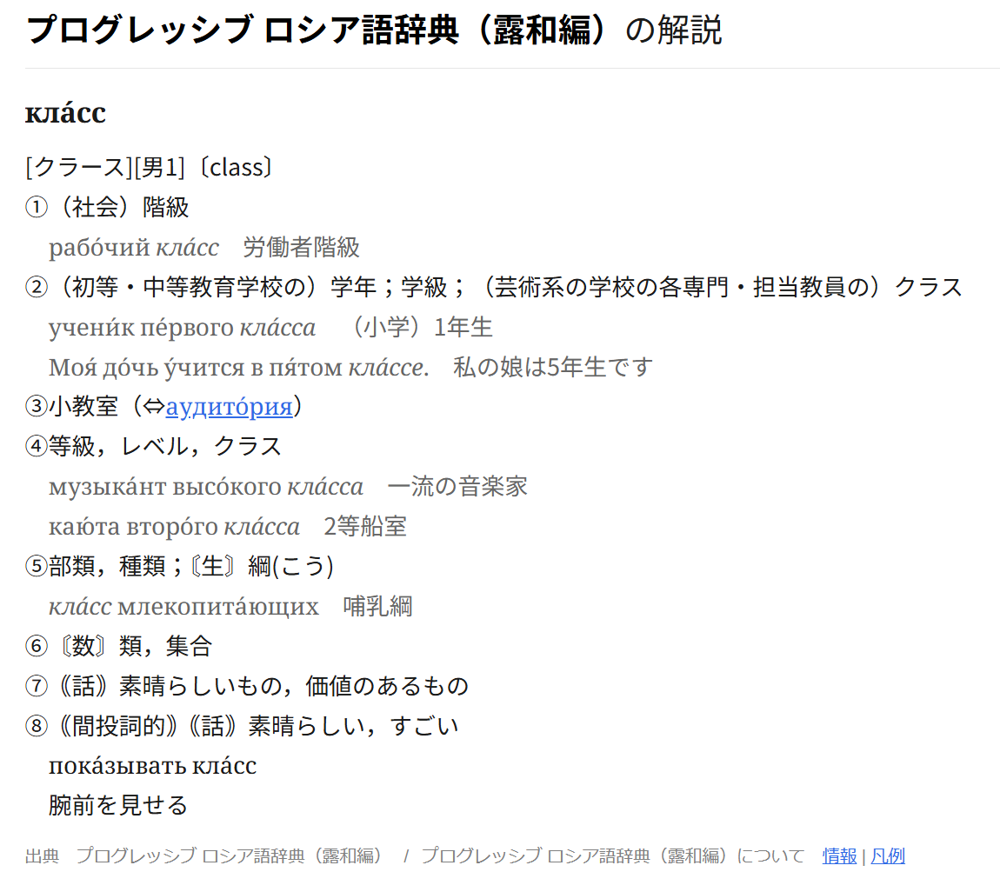
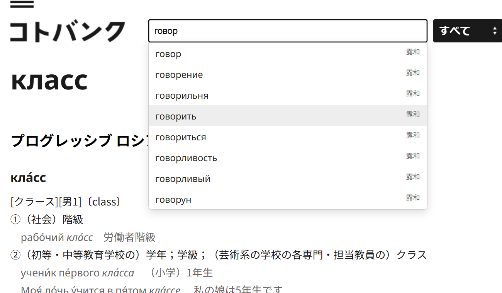

# コトバンク ロシア語辞典：表示補正・検索サジェスト

コトバンクの「プログレッシブ ロシア語辞典」（露和・和露）を読みやすくするTampermonkey用スクリプトです。表記の補正、フォントの変更、前方一致サジェストを追加します。

## 表示例

<table>
  <tr>
    <td>
       
      <em>スクリプトなし</em>
    </td>
    <td>
       
      <em>スクリプトあり</em>
    </td>
  </tr>
</table>

*検索サジェスト*

## インストール・設定

ブラウザにTampermonkeyをインストールし、[Greasy Forkの配布ページ](https://greasyfork.org/ja/scripts/600318)で、「スクリプトをインストール」を押してください。その後Tampermonkeyの確認画面で「インストール」を押してください。

辞書ページでTampermonkeyのポップアップを開き、「表記補正」「日本語フォント」「ロシア語フォント」を切り替えられます。

## 表記・表示の補正

- 本文に残っている余分な `//`・`‐` や、`Ч//Что́` のような頭文字の重複を除きます。
- 見出しと本文で重複する発音注記・カタカナ読みは、本文側にまとめます。
- 紙辞書の表記に合わせ、`((話))` は `｟話｠`、`〚料理〛` は `〘料理〙` に整え、格指定などの文法ラベルは角丸の四角枠で表示します。
- 用例・準見出しを字下げし、用例を灰色にします。和露の活用型の用例は通常色、準見出しの日本語は太字にします。
- 日本語とロシア語の区切り記号を空白に置き換えます。和露のロシア語別表現を区切る `｜` は残します。
- 和露の `①寒気хо́лод` のような表記には、日露間に空白を入れます。
- 元のサイトでは画面幅によって本文が18pxから30pxに大きくなるため、画面幅にかかわらず18pxにそろえます。

表記補正はON/OFFを切り替えられます。

## フォント

日本語とロシア語の書体をそれぞれ選べます。

| 対象 | 書体 |
|---|---|
| 日本語・括弧・数字・英字など | Noto Sans JP（ゴシック体）／Noto Serif JP（明朝体） |
| キリル文字・結合アクセント | Noto Sans（サンセリフ体）／Noto Serif（セリフ体） |

## 検索サジェスト

ページ上部・下部の検索窓に入力すると、露和・和露の候補を最大12件表示します。候補をクリックするか、上下キー・Tab・Shift+Tabで選んでEnterを押すと、掲載ページへ移動します。Escapeで候補を閉じます。

- 和露は漢字表記と読みの両方で検索できます。ひらがな・カタカナを区別しません。
- 検索時は大文字・小文字を区別せず、主・副アクセントを無視します。`й`・`ё`の違いは保持します。
- 「換気」「歓喜」から「寒気」のページに移動するなど、同じページに収録された同音語・別表記にも対応します。

検索範囲が「すべて」「露和」「和露」のときに両辞書の候補を表示します。候補を選ばずEnterを押すと、通常の検索を行います。本文中の成句や準見出しの複合語・派生語は、候補の対象に含まれません。

下部検索フォームでは、言語選択欄のクリック範囲が検索ボタンに重なる位置ずれも補正します。
